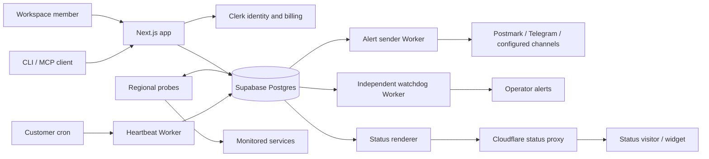

# Architecture

Staygreen is a multi-service monitoring system. The dashboard configures work; independent probes execute it; the database records state; Workers ingest heartbeats and send alerts; a separate status renderer serves public results.

## Ownership and authorization

A workspace owns apps, monitors, status pages and incidents. Its row maps to a Clerk organization; other domain rows reference the product's own identifiers. Clerk verifies member sessions and supplies organization membership and billing features. Role permissions decide who may act; billing features decide capacity.

Member writes pass through server actions or authenticated route handlers that resolve the resource's workspace and check the member's permissions. The MCP and REST surface uses verified OAuth or hashed, scoped workspace API tokens and the same service rules. Public routes do not use member claims as public credentials.

Row-level security is enabled with no browser-role policies, and browser-role grants are revoked. This blocks direct browser database access; it is not a per-workspace RLS policy. The app's privileged server connection enforces tenant isolation through resource resolution, workspace checks, scoped queries and transactional functions. Uniqueness constraints and locked transactions enforce quotas and once-only effects. Separate restricted roles give each background service only its required database functions. The ordered migrations are the source of truth for grants and legacy exceptions.

## Checks and incidents

Probes register their presence, schedule eligible monitors, check targets and confirm failures through signed peer requests. Independent location confirmation limits false alarms. Probes flush measurements and transitions into Postgres, where transactions maintain incident state and alert work. HTTP, DNS, TLS, domain and service-specific checks share target validation and credential handling. Outbound connections refuse private and other unsafe addresses rather than trusting a submitted URL, including each redirect a check follows.

Heartbeat URLs carry signed, unguessable tokens. The ingest Worker verifies and records pings through its restricted database role and Hyperdrive connection. A missed-heartbeat monitor is evaluated by the probes. The watchdog runs independently of the fleet and reads flush receipts; missing receipts mean the system may not be checking monitors, rather than proving a monitored customer app is down.

## Alerts and public status

The sender Worker claims queued deliveries with leases, reads the necessary Clerk membership, opens encrypted channel credentials, and sends through Postmark, Telegram or the configured channels. Retries and durable receipt state make repeated scheduled invocations safe. Its Telegram webhook verifies a shared secret before processing updates. The watchdog maintains separate durable receipts for operator alerts.

The status edge reads an allowlisted public snapshot with its restricted role, keeps a cache, and renders pages, summaries, badges and the widget script. It polls and listens for database changes. Cloudflare proxies the status host; Caddy terminates TLS and consults the app before issuing certificates for customer domains. Signed control requests and cache purges withdraw public content before a page becomes private. Members-only pages remain on the authenticated app surface.

The widget reads public summaries and never receives database credentials. The agent surface exposes bounded workspace operations and incident drafts; publishing an incident update remains a dashboard action. The standalone package is a CLI and stdio MCP bridge to the API, not another database client.

## Credentials and boundaries

Only the app server holds a Supabase secret API key. Probes, edge and Workers use distinct restricted database logins. Customer credentials are encrypted before storage and opened only by the services that need them. Anonymous public reads, signed heartbeat traffic, member sessions and machine tokens are separate admission paths. Origin checks, request-size limits, per-actor budgets and edge rate limits protect mutations.

The architecture permits the status service and watchdog to remain useful when the dashboard is unavailable. It does not remove the need for database backups, restore drills, monitoring, credential rotation and operator-maintained deployments. Retention cleanup and Clerk deletion webhooks are not implemented merely by deploying these services.
